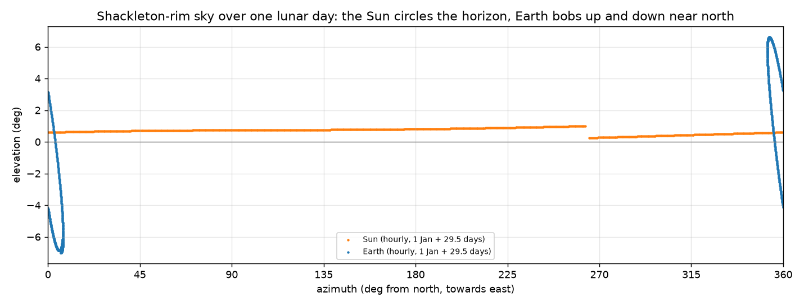

# Lunar Landing Site Navigator (NASA Space Apps 2026, Piraeus)

Compare candidate landing sites near the lunar south pole: when is each site in sunlight
(power) and when can it see Earth (direct-to-Earth communication)?

## Status
- [x] **Block 1: Sun and Earth in the lunar sky** (`moon_sky.py`): validated against JPL Horizons
- [ ] Block 2: local horizon from LRO/LOLA terrain
- [ ] Block 3: solar power and Earth link budget
- [ ] Block 4: app (Python)
- [ ] Block 5: pitch

## Setup
```bash
py -3.14 -m venv .venv
.venv\Scripts\activate
pip install -r requirements.txt
python download_kernels.py      # NASA/JPL SPICE data, ~45 MB
python step1_validate.py        # block 1 check against JPL Horizons
```

## Block 1: how it works
`moon_sky.sky_positions(target, lat, lon, times)` returns the azimuth, elevation and distance of
the Sun or Earth as seen from a point on the Moon.

1. NASA/JPL's ephemeris (DE440) gives where the Sun, Earth and Moon are; the lunar orientation
   file gives how the Moon is turned at that moment, including its small wobbles (libration).
2. SPICE returns the vector from the site to the target in the Moon-fixed **MOON_ME** frame
   (the frame LRO terrain maps use), corrected for light travel time and aberration.
3. We rotate that vector into local **East, North, Up** axes at the site and read off
   `elevation = asin(up/|v|)` and `azimuth = atan2(east, north)`.

### Validation (every hour of 2027, 3 sites × Sun and Earth = 52,560 comparisons)
| Check | Worst difference |
|---|---|
| Our East/North/Up rotation vs SPICE's own az/el routine | 0.006 arcsec |
| Ours vs NASA JPL Horizons (independent software) | 0.006 arcsec direction, 5 m distance |

0.006 arcsec is 1.7 millionths of a degree, about the size Horizons' own printed values are
rounded to. Sun or Earth positions are therefore not a source of error; terrain will be.

### What it shows


- **Sun (89.9°S):** never higher than ±1.63°, which is the Moon's 1.54° axis tilt plus the
  0.1° the site sits off the pole. The slow cycle (about 11.5 months, the "eclipse year") is the lunar season. Over
  flat ground the Sun would be up only 51% of 2027; a high rim can do far better, which is why
  terrain (block 2) matters.
- **Earth:** goes up and down between about −7° and +7° every ~27 days, because the Moon nods
  slightly as it orbits (libration in latitude). Even at the pole, Earth is below a flat horizon
  52% of the time. 4° further north, on the near side, Malapert sees Earth 68% of the time.



