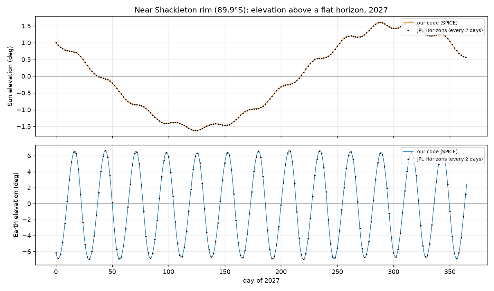
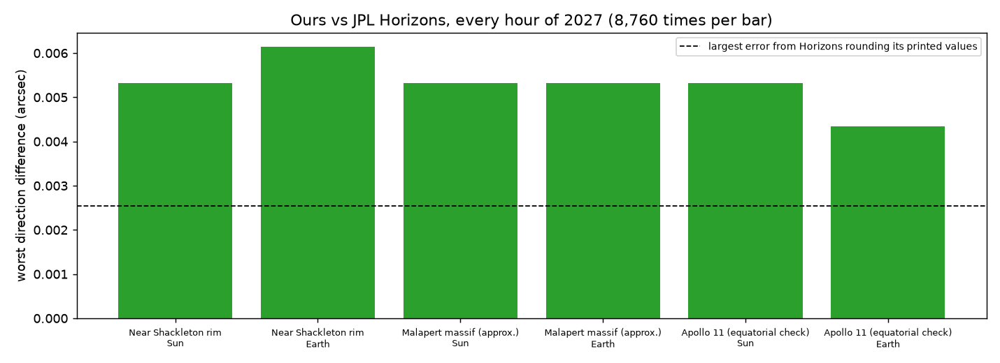
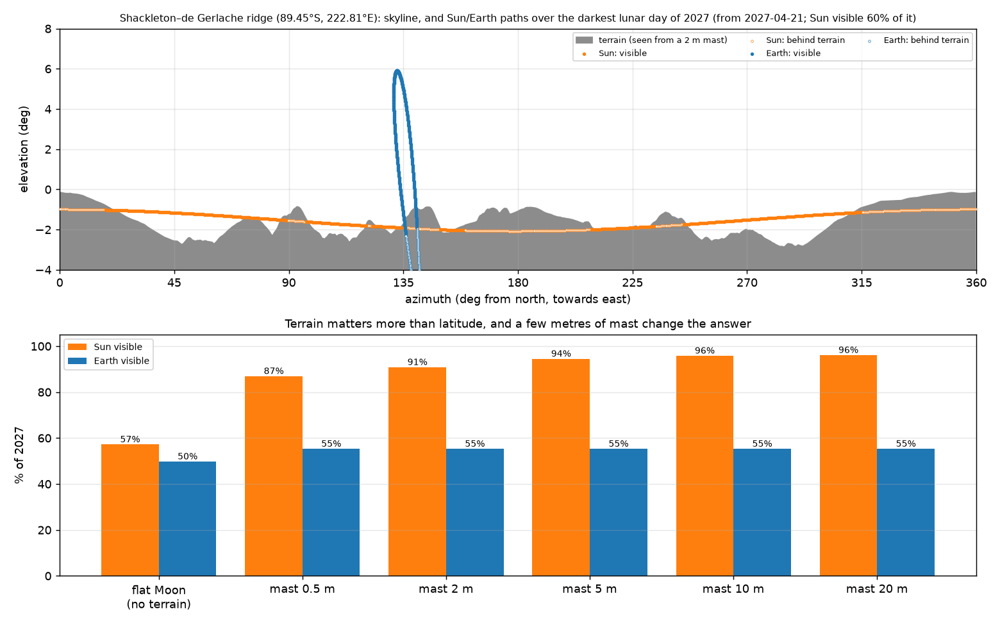

# Lunar Landing Site Navigator (NASA Space Apps 2026, Piraeus)

Compare candidate landing sites near the lunar south pole: when is each site in sunlight
(power) and when can it see Earth (direct-to-Earth communication)?

## Status
- [x] **Block 1: Sun and Earth in the lunar sky** (`moon_sky.py`): validated against JPL Horizons
- [x] **Block 2: local horizon from LRO/LOLA terrain** (`terrain.py`): validated against NASA's illumination maps
- [ ] Block 3: solar power and Earth link budget
- [ ] Block 4: app (Python)
- [ ] Block 5: pitch

## Setup
```bash
py -3.14 -m venv .venv
.venv\Scripts\activate
pip install -r requirements.txt
python download_kernels.py      # NASA/JPL SPICE data, ~45 MB
python step1_validate.py        # block 1 check against JPL Horizons
python download_terrain.py      # LOLA terrain + NASA illumination maps, ~0.6 GB
python step2a_terrain_checks.py # block 2 internal checks
python step2b_validate_vs_nasa.py  # block 2 vs NASA's 18.6-year illumination maps (~1 min)
python step2c_site_demo.py      # example site figure
```

## Block 1: how it works
`moon_sky.sky_positions(target, lat, lon, times)` returns the azimuth, elevation and distance of
the Sun or Earth as seen from a point on the Moon.

1. NASA/JPL's ephemeris (DE440) gives where the Sun, Earth and Moon are; the lunar orientation
   file gives how the Moon is turned at that moment, including its small wobbles (libration).
2. SPICE returns the vector from the site to the target in the Moon-fixed **MOON_ME** frame
   (the frame LRO terrain maps use), corrected for light travel time and aberration.
3. We rotate that vector into local **East, North, Up** axes at the site and read off
   `elevation = asin(up/|v|)` and `azimuth = atan2(east, north)`.

### Validation (every hour of 2027, 3 sites × Sun and Earth = 52,560 comparisons)
| Check | Worst difference |
|---|---|
| Our East/North/Up rotation vs SPICE's own az/el routine | 0.006 arcsec |
| Ours vs NASA JPL Horizons (independent software) | 0.006 arcsec direction, 5 m distance |

0.006 arcsec is 1.7 millionths of a degree, about the size Horizons' own printed values are
rounded to. Sun or Earth positions are therefore not a source of error; terrain will be.

### What it shows


- **Sun (89.9°S):** never higher than ±1.63°, which is the Moon's 1.54° axis tilt plus the
  0.1° the site sits off the pole. The slow cycle (about 11.5 months, the "eclipse year") is the lunar season. Over
  flat ground the Sun would be up only 51% of 2027; a high rim can do far better, which is why
  terrain (block 2) matters.
- **Earth:** goes up and down between about −7° and +7° every ~27 days, because the Moon nods
  slightly as it orbits (libration in latitude). Even at the pole, Earth is below a flat horizon
  52% of the time. 4° further north, on the near side, Malapert sees Earth 68% of the time.




## Block 2: how it works
`terrain.horizon_profile(dem, lat, lon, obs_height_m)` returns the terrain horizon (elevation
angle of the skyline) in 720 compass directions around a site.

Terrain: LOLA `LDEM_80S_40M` (NASA PDS), 40 m pixels from 80°S to the pole, in the same MOON_ME
frame as block 1.

1. From the site, walk outward along great circles in each direction: every 20 m out to 4 km,
   then in steps of 0.5 % of the distance, out to the edge of the map.
2. Read the terrain height at each point (bilinear interpolation).
3. Put the site and each terrain point in 3-D and take the elevation angle
   `asin((Q − P)·up / |Q − P|)`. Working in 3-D makes the Moon's curvature automatic.
4. The horizon in that direction is the largest angle. The Sun or Earth counts as visible when
   any part of its disc is above it (the same definition NASA uses).

### Checks
| Check | Result |
|---|---|
| Map projection signs vs the separate global map LDEM_16 | correlation 0.9994 for the chosen convention, below 0.31 for the 3 others (my first guess was wrong; this check caught it) |
| Smooth sphere (all heights 0): horizon = textbook dip −acos(R/(R+h)) | error below 0.00001° for 2 m, 100 m, 1000 m eye heights |
| Ray marching vs brute force over every pixel 5–100 km away, 3 sites | mean difference ≤ 0.02°, 95 % within 0.08° |
| **Sunlight and Earth visibility vs NASA's LOLA team maps** (Mazarico et al., 18.6-year averages), 142 sites | Sun: median difference 0.5 percentage points, correlation 0.993. Earth: 0.1 points, 0.993. Brightest site: 85.7 % vs NASA's 86.4 % |


Remaining differences come from the terrain maps themselves: NASA's map uses an older 60 m
elevation model, ours the 2017 40 m one, and on steep crater walls a 60 m pixel and a point can
see quite different skies.

**Eye height matters.** With the eye exactly on the ground, interpolated terrain a few metres
away can hide a Sun that is only 1° up. NASA's 60 m grid avoids this by construction, so the
comparison above ignores the closest 60 m; the app uses a 2 m mast (a lander's solar panel).

### Example: the ridge between Shackleton and de Gerlache craters


- Over flat ground at this latitude, the Sun's disc would be visible 57 % of 2027. On this
  2 km high ridge it is visible **91 %** from a 2 m mast, and **96 %** from 10 m. Height
  also lowers the horizon: the ground falls away, so the Sun stays visible even at −2°.
- Earth is visible 55 % of the year, and only in a narrow window to the north-east (az ≈ 135°)
  when the Moon's wobble lifts it up.
- Darkest lunar day of 2027 (from 21 April): the Sun is visible only 60 % of the time.
