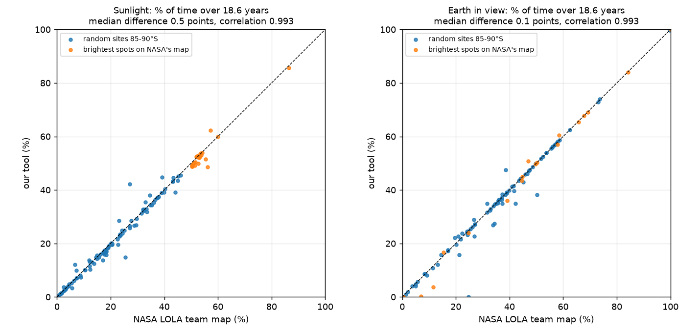
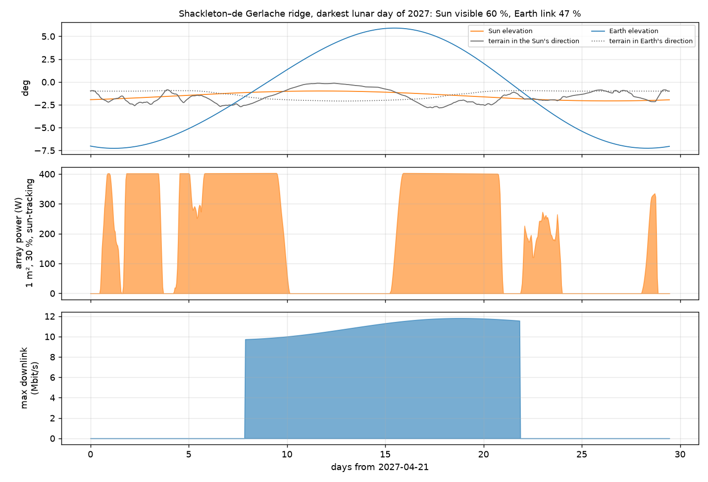
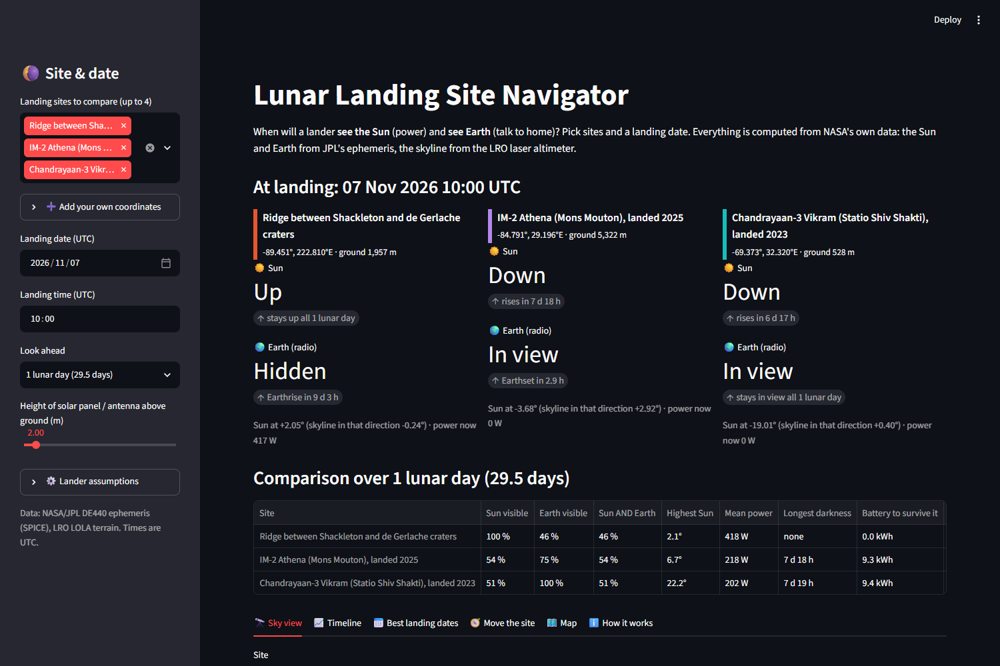
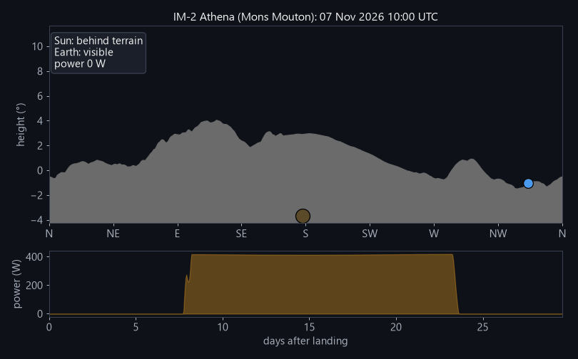

# Lunar Landing Site Navigator (NASA Space Apps 2026, Athens)

Compare candidate landing sites near the lunar south pole: when is each site in sunlight
(power) and when can it see Earth (direct-to-Earth communication)?

## Status
- [x] **Block 1: Sun and Earth in the lunar sky** (`moon_sky.py`): validated against JPL Horizons
- [x] **Block 2: local horizon from LRO/LOLA terrain** (`terrain.py`): validated against NASA's illumination maps
- [x] **Block 3: solar power, Earth link budget, windows and time until sunset/Earthset** (`ops.py`)
- [x] **Block 4: the app** (`app.py`, Streamlit): curated sites, sky view, timeline, best landing dates, move-the-site grid, maps
- [x] **Block 5: pitch**: `pitch/Lunar_Landing_Site_Navigator.pptx` (+ PDF) and `pitch/demo_script.md`

## Setup
```bash
py -3.14 -m venv .venv
.venv\Scripts\activate
pip install -r requirements.txt
python download_kernels.py      # NASA/JPL SPICE data, ~45 MB
python step1_validate.py        # block 1 check against JPL Horizons
python download_terrain.py      # LOLA terrain + NASA illumination maps, ~1.1 GB
python step2a_terrain_checks.py # block 2 internal checks
python step2b_validate_vs_nasa.py  # block 2 vs NASA's 18.6-year illumination maps (~1 min)
python step2c_site_demo.py      # example site figure
python step3_power_comms.py     # block 3 checks + timeline figure
python step4a_global_terrain.py # global terrain checks + all curated sites
python test_app.py              # app smoke test (runs it headless)
streamlit run app.py            # the app, in your browser
```
On Windows, double-click `run_app.bat` to start the app.

## Block 1: how it works
`moon_sky.sky_positions(target, lat, lon, times)` returns the azimuth, elevation and distance of
the Sun or Earth as seen from a point on the Moon.

1. NASA/JPL's ephemeris (DE440) gives where the Sun, Earth and Moon are; the lunar orientation
   file gives how the Moon is turned at that moment, including its small wobbles (libration).
2. SPICE returns the vector from the site to the target in the Moon-fixed **MOON_ME** frame
   (the frame LRO terrain maps use), corrected for light travel time and aberration.
3. We rotate that vector into local **East, North, Up** axes at the site and read off
   `elevation = asin(up/|v|)` and `azimuth = atan2(east, north)`.

### Validation (every hour of 2027, 3 sites × Sun and Earth = 52,560 comparisons)
| Check | Worst difference |
|---|---|
| Our East/North/Up rotation vs SPICE's own az/el routine | 0.006 arcsec |
| Ours vs NASA JPL Horizons (independent software) | 0.006 arcsec direction, 5 m distance |

0.006 arcsec is 1.7 millionths of a degree, about the size Horizons' own printed values are
rounded to. Sun or Earth positions are therefore not a source of error; terrain will be.

### What it shows


- **Sun (89.9°S):** never higher than ±1.63°, which is the Moon's 1.54° axis tilt plus the
  0.1° the site sits off the pole. The slow cycle (about 11.5 months, the "eclipse year") is the lunar season. Over
  flat ground the Sun would be up only 51% of 2027; a high rim can do far better, which is why
  terrain (block 2) matters.
- **Earth:** goes up and down between about −7° and +7° every ~27 days, because the Moon nods
  slightly as it orbits (libration in latitude). Even at the pole, Earth is below a flat horizon
  52% of the time. 4° further north, on the near side, Malapert sees Earth 68% of the time.


## Block 2: how it works
`terrain.horizon_profile(dem, lat, lon, obs_height_m)` returns the terrain horizon (elevation
angle of the skyline) in 720 compass directions around a site.

Terrain: LOLA `LDEM_80S_40M` (NASA PDS), 40 m pixels from 80°S to the pole, in the same MOON_ME
frame as block 1.

1. From the site, walk outward along great circles in each direction: every 20 m out to 4 km,
   then in steps of 0.5 % of the distance, out to the edge of the map.
2. Read the terrain height at each point (bilinear interpolation).
3. Put the site and each terrain point in 3-D and take the elevation angle
   `asin((Q − P)·up / |Q − P|)`. Working in 3-D makes the Moon's curvature automatic.
4. The horizon in that direction is the largest angle. The Sun or Earth counts as visible when
   any part of its disc is above it (the same definition NASA uses).

### Checks
| Check | Result |
|---|---|
| Map projection signs vs the separate global map LDEM_16 | correlation 0.9994 for the chosen convention, below 0.31 for the 3 others (my first guess was wrong; this check caught it) |
| Smooth sphere (all heights 0): horizon = textbook dip −acos(R/(R+h)) | error below 0.00001° for 2 m, 100 m, 1000 m eye heights |
| Ray marching vs brute force over every pixel 5–100 km away, 3 sites | mean difference ≤ 0.02°, 95 % within 0.08° |
| **Sunlight and Earth visibility vs NASA's LOLA team maps** (Mazarico et al., 18.6-year averages), 142 sites | Sun: median difference 0.5 percentage points, correlation 0.993. Earth: 0.1 points, 0.993. Brightest site: 85.7 % vs NASA's 86.4 % |



Remaining differences come from the terrain maps themselves: NASA's map uses an older 60 m
elevation model, ours the 2017 40 m one, and on steep crater walls a 60 m pixel and a point can
see quite different skies.

**Eye height matters.** With the eye exactly on the ground, interpolated terrain a few metres
away can hide a Sun that is only 1° up. NASA's 60 m grid avoids this by construction, so the
comparison above ignores the closest 60 m; the app uses a 2 m mast (a lander's solar panel).

### Example: the ridge between Shackleton and de Gerlache craters


- Over flat ground at this latitude, the Sun's disc would be visible 57 % of 2027. On this
  2 km high ridge it is visible **91 %** from a 2 m mast, and **96 %** from 10 m. Height
  also lowers the horizon: the ground falls away, so the Sun stays visible even at −2°.
- Earth is visible 55 % of the year, always low in the south-east (az ≈ 137°, the direction
  across the pole towards the near side), and only when the Moon's wobble lifts it up.
- Darkest lunar day of 2027 (from 21 April): the Sun is visible only 60 % of the time.

## Block 3: power, communication, and "how long until sunset?"
`ops.SiteTimeline(lat, lon, start, stop)` combines blocks 1 and 2 for one site and returns, hour
by hour: how much of the Sun's disc clears the terrain, solar-array power, whether Earth's
centre clears the terrain (radio contact), and the maximum downlink rate. `summary()` gives
the headline numbers, and `time_until_change(t)` answers "the Sun is up; when does it set?"
to the minute.

**Default assumptions** (editable in the app):
- **Solar array:** 1 m², 30 % efficient cells, vertical panel turned towards the Sun (polar
  landers), or a flat deck panel (equatorial landers). Sunlight 1361 W/m² × (1 AU / distance)².
- **Radio:** X-band (8.45 GHz), 10 W transmitter, 0.3 m dish on the lander, a 12 m class
  ground station (G/T 37 dB/K; NASA's 34 m dishes are about 53 dB/K), coded link needing
  Eb/N0 = 2.5 dB, plus a 3 dB margin. The result is the rate the link can carry; a real radio
  may cap it lower.

### Checks
| Check | Result |
|---|---|
| Partly hidden Sun: segment-area formula vs 400,000 random points in the disc | max difference 0.0009 (the counting noise) |
| Flat panel at Apollo 11 over 12 lunar days vs hand formula S·A·η·cos(lat)/π | 129.56 W vs 129.83 W (−0.2 %; the formula ignores the Sun's ±1.5° tilt and the disc crossing the horizon) |
| Link budget in dB vs the same link in plain SI units (Friis) | identical (10.7 Mbit/s at 384,400 km) |
| Time until sunset/sunrise: search + refinement vs scanning every minute, 8 random moments | identical; this checks the window-search logic, at 1 minute resolution |

### Example: the ridge between Shackleton and de Gerlache craters, 2027


- Sun visible 91 % of the year; a 1 m² array averages 354 W (≈400 W when fully lit).
- Longest darkness: 121 h (5 days). Surviving it on a 50 W heater/computer load needs a 6 kWh
  battery.
- Earth in view 51 % of the year, but the longest radio silence is 318 h (13 days): the dark
  side of the Moon's monthly nod. Sun **and** Earth together: 47 %.

### Known limits
- Hourly steps: a Sun peeking through a gap for less than an hour can be missed.
- Ground-station side: assumes some station on Earth can see the Moon (true for most of the
  time with three stations spread around the globe), and no weather or scheduling.
- No thermal model yet.

## Block 4: the app
`streamlit run app.py` opens the Lunar Landing Site Navigator in the browser. It runs fully
offline once `data/` and `kernels/` are downloaded.



- **Sidebar:** up to 4 sites from a curated list (`sites.py`: Apollo 11–17, IM-1, IM-2,
  Chandrayaan-3, SLIM, Blue Ghost, Chang'e 4/5/6, the brightest south-pole ridge, Shackleton's
  shadowed floor) or your own coordinates; landing date and time; look-ahead period; mast height;
  panel and radio assumptions.
- **At landing:** for each site, whether the Sun and Earth are up and **how long until sunset /
  Earthset** (or sunrise / Earthrise).
- **Comparison table:** sunlight, Earth visibility, both together, mean power, longest darkness,
  battery needed to survive it, longest radio silence.
- **Sky view:** the skyline with the Sun's and Earth's paths; hidden parts in pale colours.
- **Timeline:** when the Sun and Earth are visible, solar power, maximum downlink rate.
- **Best landing dates:** for every landing day in the next year, how much sunlight and Earth
  contact a mission of N days gets. Answers "the launch slipped two weeks, now what?"
- **Move the site:** 9 × 9 grid of sunlight / Earth visibility around a site (100 m – 2 km
  spacing): small moves, big changes.
- **Map:** south-pole relief and a whole-Moon map with the sites.

### Global terrain checks (step4a)
| Check | Result |
|---|---|
| Global 474 m map vs the separate global 1.9 km map | correlation 0.9997 |
| Global 474 m map vs the polar 40 m map, 80.5–87°S | correlation 0.99998, rms 12 m |
| Composite terrain vs polar-only, near the pole | identical horizon |

Headline numbers for 2027 (2 m mast) for all curated sites are in `results/step4a_global.json`.
Sanity checks that come out right: Earth is never visible from the far-side Chang'e 4 and 6
sites (they needed a relay satellite) and always visible from the near-side sites; the Shackleton
floor never sees the Sun; and at Chandrayaan-3's site the tool puts sunrise on 21 Aug 2023 and
sunset on 4 Sep 2023 (ISRO landed on 23 Aug at the start of the lunar day and put the lander to
sleep on 4 Sep).

### Extras
- **🏔️ 3D terrain tab:** LOLA terrain around the site (2–40 km, adjustable vertical
  exaggeration, Moon's curvature included) with lines towards the Sun and Earth; drag the
  "hours after landing" slider to move them through the lunar day.
- **One lunar day, animated** (`make_lunar_day_gif.py`): IM-2 site from 7 Nov 2026. The Sun
  climbs out from behind the hills after 7.7 days, then sets again after 23 days.



## Block 5: pitch
`pitch/build_deck.py` builds the 5-slide deck (speaker notes included); `pitch/render.ps1`
exports PNGs and the PDF with PowerPoint. The story: *"Your launch slipped two weeks"* at the
IM-2 site (14-day mission, numbers from `pitch_numbers.py`, `results/pitch_story.json`):

| Landing day | Sun visible | Earth visible | Longest night |
|---|---|---|---|
| 7 Nov 2026 (planned) | 45 % | 65 % | 7.7 days |
| 21 Nov (2-week slip) | 69 % | 93 % | 4.4 days |
| 15 Nov (best day) | 100 % | 100 % | none |
